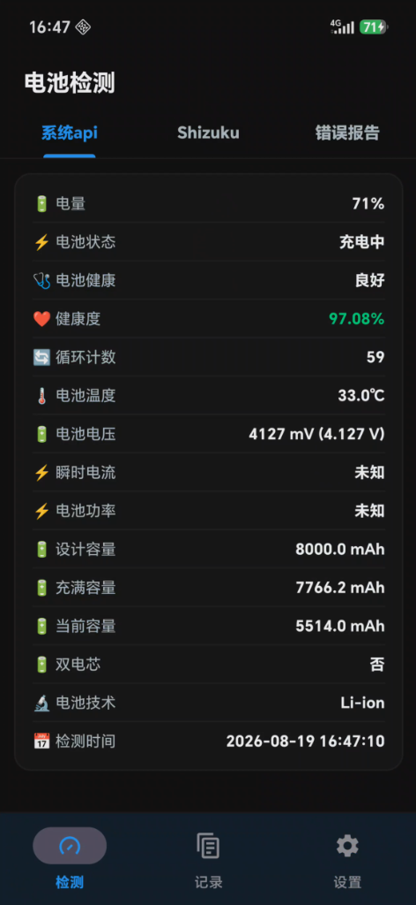
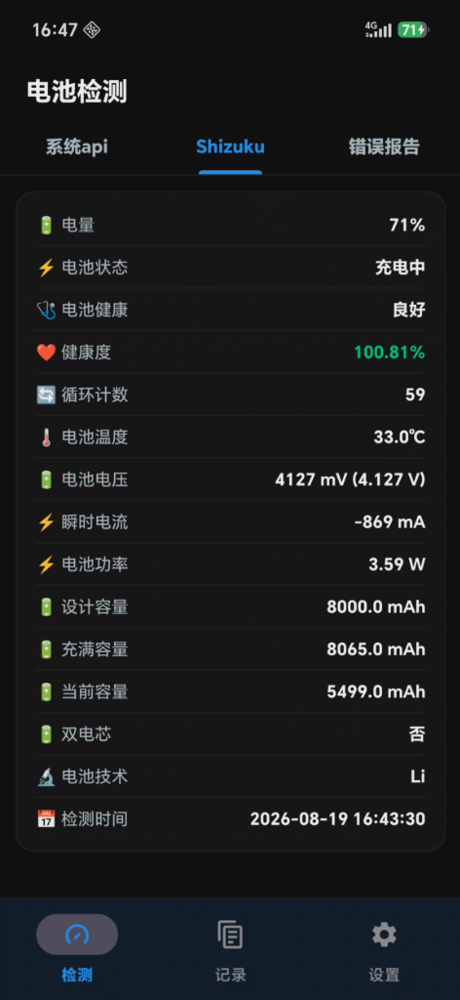
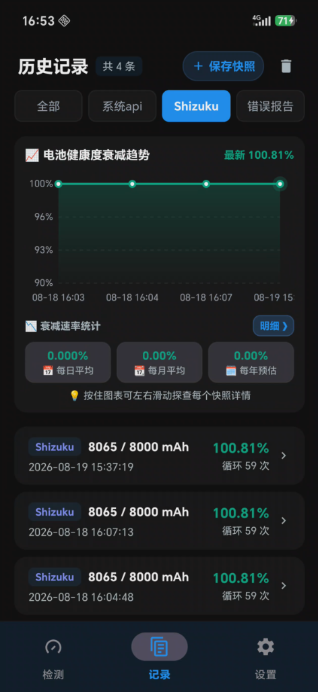
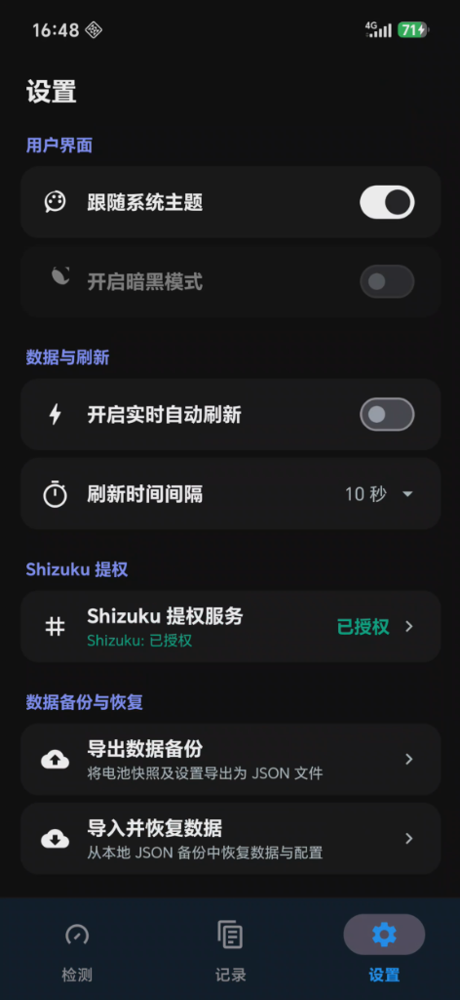

<h1 align="center">🔋 Battery (电池统计与健康分析)</h1>

<p align="center">
  <strong>一款专为 Android 设计的轻量、精准、专业、现代的电池充放电能耗统计、硬件健康度与快充监测工具。</strong>
</p>

<p align="center">
  <a href="README.md">简体中文</a> | <a href="README_EN.md">English</a>
</p>

<p align="center">
  
  
  
  
  
  
</p>

---

## 📱 界面预览

<div align="center">

| 📊 耗电统计与时间轴 | 🔋 系统 API 检测 | ⚡ Shizuku 提权检测 | 📈 历史趋势与衰减统计 | ⚙️ 设置与数据备份 |
| :---: | :---: | :---: | :---: | :---: |
|  |  |  |  |  |

</div>

---

## 🌟 核心特性概览

```
Battery
├── 📊 耗电统计与能耗分析 (放电轨迹时间轴 · 亮屏/息屏/深度睡眠拆解 · 应用能耗排行 · 7天基准续航测算)
├── ⚡ 充电统计与快充监测 (功率/电量/温度三合一走势 · 息屏快充细分 · 充入有效能量 Wh · 真实物理功率)
├── 🩺 电池健康度分析 (系统 API · Shizuku 提权穿透 · Bugreport 秒级流式解析 · 贝塞尔衰减走势)
├── 🛡️ 全方位后台保活防杀 (前台通知常驻 · 无障碍秒级自愈 · PID 1 特权守护进程 · 智能省电采样)
└── ⚙️ 硬件校准与数据安全 (电流倍率/极性/库仑计差分校准 · JSON 完整备份与去重恢复 · Material 3)
```

---

## 📖 详细功能介绍

### 一、📊 耗电统计与深度能耗分析 (Power Usage Analysis)

* **智能双模自动感应**：
  - 拔掉充电器瞬间自动启动全新放电周期并记录初始基准电量；
  - 接入充电器时自动为本次放电会话生成历史快照并无缝切换至充电监测界面。
* **全维度核心放电指标矩阵**：
  - **运行功耗 (W)**：实时与平均整机放电功率，直观评估各阶段瞬时负荷；
  - **消耗能量 (Wh / J)**：精准物理数值积分，展示实际放电有效能量及占拔电时总储备比例；
  - **放电时间与理论续航**：实时测算亮屏使用时长、息屏待机时长，并基于当前剩余能量推算剩余理论可用时间；
  - **息屏工况智能细分**：精准分离并统计**息屏总体**、**唤醒 (Awake)** 与**深度睡眠 (Deep Sleep)** 的时长与能耗占比；
  - **放电速度与满电续航推算**：提供亮屏放电速度、息屏放电速度及全局放电速度，结合**最近 7 天放电统计基准**科学推算满电可用时长。
* **Canvas 硬件加速交互式放电时间轴 (Timeline)**：
  - 动态连续记录自本次放电以来的所有采样点，支持手势横向滑动与多点触控缩放；
  - **多维指标单选切换**：功耗曲线 (W)、电量曲线 (%)、温度与电压 (℃ / V)；
  - **活跃应用打点联动**：在时间轴下方精准标记对应时段的前台活跃应用，高耗电波段一目了然。
* **应用能耗账本与下钻详情 (App Energy Ranking & Drill-down)**：
  - **双数据源采集机制**：
    - **Shizuku 权威账本模式**：免 Root 直接读取 Android 底层 `dumpsys batterystats` 权威功耗账本，提取应用物理消耗 (mAh) 与硬件分摊；
    - **标准模式**：基于系统使用情况访问权限 (UsageStats) 与硬件基准模型科学估算；
  - **多维灵活排序**：支持按使用时长、放电功耗 (W)、消耗电量 (mAh/%)、应用名称排序；
  - **后台统计开关**：独立统计并展示后台应用的平均功耗、后台运行时长与后台消耗能量；
  - **应用能耗下钻弹窗**：点击应用条目弹出专属能耗明细及专属时间轴分布；
  - **已卸载应用智能标识**：精准归集已卸载应用的残留消耗。
* **耗电历史记录与快照复盘**：
  - 拔电自动保存快照，支持随时手动保存快照与重置采样数据；
  - 提供亮屏、息屏、总计综合平均功耗与放电速度历史总结明细；
  - 支持将历史快照一键载入主页复盘，并可随时一键切回实时监测状态。

---

### 二、⚡ 充电统计与快充效率监测 (Charging Stats & Fast Charge Monitoring)

* **三合一多维充电走势图表**：
  - 实时绘制**橙黄色功率曲线 (W)**、**蓝色电量曲线 (%)** 与**红色温度曲线 (℃)**；
  - 增量对比追加渲染引擎，杜绝全量重绘闪烁，支持手势横向拖动探查；
  - 图表下方实时展示带专属色块的数值看板。
* **全景充电物理参数看板**：
  - **电池端实时充放电功率 (W)**：电芯两端实时能量流动速率（当前电压 × 当前电流）；
  - **充电器 USB 接口输入总功率 (W)**：Type-C 输入端口实时物理功率（仅展示真实传感器读数，杜绝虚构估算）；
  - **全程平均功率 (AVG)** 与**峰值功率 (MAX)**：真实记录快充协议握手峰值与全程平准供给效率；
  - **充入物理能量 (Wh)**：基于时间积分算法精准测算充入电芯的真实有效电量；
  - **电芯实时温度与全程最高温度 (MAX)**：基于 NTC 热敏电阻采样，过热风险即刻感知；
  - **实时端电压 (V)** 与**瞬时充放电流 (mA)**。
* **息屏快充细分统计**：
  - 智能区分亮屏与息屏状态，独立统计息屏充电时长、息屏充入电量及充入能量占比；
  - 直观对比亮屏与息屏工况下的快充握手效率与温控表现。
* **充电历史与会话复盘**：
  - 每次插拔充电自动生成完整充电会话记录，支持按列表查阅；
  - 充电会话详情页提供完整走势图表、核心指标矩阵及总结看板。
* **充电实用辅助**：
  - 支持在设置中开启“充电时保持屏幕常亮”，方便在桌面无线充或快充支架上实时观察走势。

---

### 三、🩺 电池健康度检测与衰减分析 (Battery Health & SoH Analysis)

* **三重数据采集与深度解析引擎**：
  1. **系统标准 API (BatteryManager)**：零门槛读取系统广播与标准接口数据（电量、状态、健康状态、温度、电压、电流等）；
  2. **Shizuku 提权深度穿透 (Rootless ADB)**：
     - 免 Root，通过 Shizuku 授权获取底层 shell 与 Linux 内核驱动读取权限；
     - 穿透读取 `/sys/class/power_supply/` 驱动节点与 Linux 电量计 IC 硬件寄存器；
     - 读取电量计真实充满容量（FCC）、真实等效循环次数（Cycle Count）、微安级瞬时电流与双电芯架构；
     - 深度适配荣耀（HONOR）等机型私有驱动节点；
  3. **错误报告 (Bugreport) 极速秒级解析**：
     - 支持直接导入系统错误报告压缩包（`bugreport-*.zip` 或 `.txt`）；
     - 采用原生**字节流滑动窗口快扫技术**，毫秒级快速定位并结构化解析 `getHealthInfo` 核心结构体；
     - 自动提取并展示错误报告实际抓取与生成的时间戳。
* **15 项全维度电池硬件参数清洗**：
  每一项参数均经过严格清洗与物理量纲换算，拒绝假数据：

  | 参数项 | 说明 | 物理原理 / 数据来源 |
  | :--- | :--- | :--- |
  | 🔋 **当前电量** | 剩余电量百分比（如 `85%`） | 系统 API / 底层节点 |
  | ⚡ **电池状态** | 充电中 / 放电中 / 未充电 / 已充满 | 电源管理芯片硬件状态 |
  | 🩺 **电池健康** | 诊断状态（良好 / 过热 / 损坏 / 过压 / 低温） | Android 诊断接口 |
  | ❤️ **健康度 (SoH)** | 真实健康度百分比（充满容量 FCC ÷ 设计容量） | 电池黄金公式精准测算 |
  | 🔄 **循环计数** | 电量计记录的等效完整充放电循环次数 | 底层硬件库仑计寄存器 |
  | 🌡️ **电池温度** | 实时摄氏度（精确至 `0.1℃`） | 电池内置 NTC 热敏电阻 |
  | 🔋 **电池电压** | 实时端电压（`V` / `mV`） | 模数转换器 (ADC) 采样 |
  | ⚡ **瞬时电流** | 实时充放电电流（`mA`，充放极性分明） | 库仑计采样电阻 |
  | ⚡ **电池功率** | 实时瞬时工作功率（`W` 瓦数） | 端电压 × 瞬时电流 |
  | 🔋 **设计容量** | 厂商出厂额定设计总容量（`mAh`） | PowerProfile / 底层出厂参数 |
  | 🔋 **充满容量 (FCC)** | 电池当前完全充满时的物理容量估算（`mAh`） | 芯片电量计自学习物理值 |
  | 🔋 **当前容量** | 当前剩余可用电荷容量（`mAh`） | 硬件电荷计数器 |
  | 🔋 **双电芯架构** | 是否为双串联 / 双并联电芯硬件拓扑 | 底层硬件拓扑识别 |
  | 🔬 **电池技术** | 电池材料类型（如 `Li-ion`、`Li-poly`） | 硬件属性识别 |
  | ⏱️ **检测时间** | 该次检测或错误报告生成的精确日期时间 | 自动生成或报告时间戳 |

* **平滑贝塞尔健康度趋势图与损耗统计**：
  - 基于 Canvas 硬件加速拟合历史快照曲线，支持手势左右滑动探查每个快照节点详情；
  - **日/月/年健康度衰减速率推算**：每日平均衰减值 (%/天)、每月平均衰减值 (%/月)、每年预估衰减值 (%/年)；
  - **日/月/年充放电循环消耗统计**：日均循环消耗、月均循环消耗、年均预估消耗；
  - **周期损耗明细分组**：按自然日、自然月、自然年自动聚合，清晰展示每个周期的起止健康度变化与循环增量。

---

### 四、🛡️ 全方位后台常驻、防杀保活与自愈体系 (Keep-Alive & Background Architecture)

针对国内定制系统（澎湃/MIUI、ColorOS、OriginOS、MagicOS/EMUI 等）激进的杀后台机制，构建了多重防杀保活与自愈防线：

* **常驻前台通知栏监控**：
  - 显示电量百分比、充放电实时功率、端电压与温度；
  - 借助 Android 前台服务机制获得更高的进程优先级。
* **三级防杀与自愈防线**：
  1. **方案一：无障碍秒级自愈 (免 Root / 免 ADB)**：
     - 利用系统标准无障碍服务（`AccessibilityService`）机制；
     - 当应用被多任务划杀或系统清理后，系统无障碍守护机制将在秒级内重新唤醒拉活核心服务；
     - 无需电脑 ADB，无需 Root 权限，开箱即用，不收集任何用户隐私。
  2. **方案二：特权独立守护进程 (终极防杀)**：
     - 通过 `app_process` 独立运行于宿主进程之外，直接挂载在 Linux init (PID 1) 树下；
     - 具备 Linux 系统最高级 -1000 OOM 免疫级别，完全无视多任务一键划杀与系统管家强杀；
     - 支持通过 **Root 权限**、**Shizuku 提权** 或 **电脑 ADB 命令行** 一键静默启动；
     - 实时双向心跳监控主进程，一旦被杀秒级静默拉活，并记录自愈拉活次数。
  3. **方案三：系统白名单配置指南**：
     - 内置各大主流手机品牌的多任务加锁、自启动权限、耗电无限制（忽略电池优化）图文引导指南。
* **精细化采样与省电策略**：
  - **三种曲线采样精度**：极限省电模式 (推荐)、标准智能模式、极客高精模式 (1 秒高频)；
  - **自定义间隔**：支持分别自定义亮屏刷新间隔与息屏采样间隔（支持精确到 0.1 秒的小数输入）；
  - **开机自启**：支持设备重启后自动恢复后台监控服务。

---

### 五、⚙️ 硬件校准、数据备份与现代体验

* **硬件电流校准引擎**：
  - **倍率调节**：支持正向/反向 10 的倍数倍率调节，完美适配驱动单位量级异常；
  - **双电芯倍率**：针对双电芯快充仅上报单电芯电流的设备，开启后自动将读数翻倍 (×2)；
  - **反转电流极性**：纠正部分机型驱动正负号反转问题；
  - **电荷库仑计差分推算**：在底层瞬时电流为 0 的设备上，利用硬件库仑计电荷差分推算真实物理电流。
* **完整数据备份与恢复**：
  - 支持将全部应用设置、健康度快照、充电历史记录、放电历史记录打包导出为规范 JSON 备份文件；
  - 导入恢复时支持“覆盖现有数据”或“合并现有数据（保留现有并去重追加）”。
* **现代 Material 3 界面与交互设计**：
  - Material 3 底部导航与动态页面增删调度；
  - 完美适配浅色模式与 AMOLED 纯黑深色模式；
  - 完整的双语国际化支持（🇨🇳 简体中文 / 🇺🇸 English / 跟随系统）；
  - 内置详尽的气泡注解与知识库引导弹窗（放电指南、充电指南、SoH 计算原理与衰减评估标准）。

---

## 🛠️ 技术架构

* **编程语言**：100% [Kotlin](https://kotlinlang.org/) + C++17 Native
* **架构模式**：MVVM (Model-View-ViewModel) + 响应式单向数据流
* **异步与并发**：Kotlin Coroutines (协程) + Flow / StateFlow
* **视图绑定**：Android Jetpack ViewBinding
* **底层解析**：C++ Native 高性能文件流解析 (`power_reader.cpp`)
* **核心组件与第三方依赖**：
  - Google Material Components 3 (`com.google.android.material:material:1.11.0`)
  - Rikka Shizuku API (`dev.rikka.shizuku:api:13.1.5` / `provider:13.1.5`)
  - AndroidX SwipeRefreshLayout (`1.1.0`)
  - AndroidX RecyclerView (`1.3.2`)
  - AndroidX Lifecycle & ViewModel KTX (`2.7.0`)
  - Kotlinx Coroutines Android (`1.7.3`)

---

## 📦 项目结构

```
Battery/
├── app/
│   ├── src/main/
│   │   ├── cpp/                        # C++17 原生高性能流式读取模块 (CMakeLists.txt, power_reader.cpp)
│   │   ├── java/com/battery/analysis/
│   │   │   ├── daemon/                 # 特权守护进程实现 (BatteryDaemonServer, DaemonManager, KeepAliveProvider)
│   │   │   ├── db/                     # 本地 SQLite 数据存储 (HistoryDbHelper, PowerUsageDbHelper, ChargingHistoryDbHelper)
│   │   │   ├── manager/                # 业务调度管理器 (PowerUsageManager, ChargingStatsManager, ShizukuManager 等)
│   │   │   ├── model/                  # 数据实体模型 (BatteryInfo, PowerUsageRecord, ChargingSessionSummary 等)
│   │   │   ├── provider/               # 数据提供者 (NormalApiProvider, ShizukuProvider, BugreportParser, Fusion)
│   │   │   ├── receiver/               # 广播监听器 (BatteryUnplugReceiver, BootReceiver, HeartbeatAlarmReceiver)
│   │   │   ├── service/                # 前台监控与自愈服务 (BatteryMonitorService, KeepAliveAccessibilityService)
│   │   │   ├── timeline/               # 交互式放电时间轴与能耗计算体系 (domain, data, presentation, util)
│   │   │   ├── ui/                     # UI 视图层 (Fragment, Activity, Adapter, 自定义图表 View)
│   │   │   ├── util/                   # 算法工具类 (能耗梯形积分, 7天放电测算, 硬件电流校准, 气泡提示)
│   │   │   ├── viewmodel/              # MVVM 状态流与生命周期 ViewModel
│   │   │   └── MainActivity.kt         # 顶级入口 Activity (导航与生命周期调度)
│   │   └── res/                        # 页面布局、矢量图标、主题配色与中英文字符资源
├── .github/workflows/                 # CI/CD 自动化构建与 Release 签名打包脚本
└── build.gradle.kts                   # 顶级与模块级构建配置 (Target SDK 36, NDK 构建等)
```

---

## 🚀 编译与构建

### 1. 环境要求
* **Android Studio**：Ladybug / Iguana / Hedgehog 或更高版本
* **JDK**：OpenJDK 17 或以上
* **Android SDK**：Compile SDK 36, Target SDK 36, Min SDK 24
* **NDK & CMake**：CMake 3.22.1+，NDK 25+

### 2. 本地编译步骤
```bash
# 克隆仓库
git clone https://github.com/zhyang18/Battery.git
cd Battery

# 编译 Debug 版 APK
./gradlew assembleDebug

# 编译 Release 版 APK
./gradlew assembleRelease
```
编译产物位于 `app/build/outputs/apk/` 目录下。

---

## 📱 使用指南

1. **耗电统计**：
   - 拔掉充电器后自动开始记录放电数据。可在页面顶部查看放电功耗、能量、亮屏/息屏及理论续航；
   - 在下方时间轴中切换查看功耗、电量、温度曲线，并在应用列表中查看前后台应用能耗详情；
   - 首次使用可在 Shizuku 模式与标准模式之间选择。
2. **充电统计**：
   - 插入充电器后，应用自动切换至“充电”页面，动态绘制功率、电量与温度走势曲线；
   - 拔出充电器时自动结束充电并归档至充电历史记录。
3. **电池健康度检测**：
   - 打开“健康度”页面，向下拉动即可刷新普通 API 参数；
   - 切换至“Shizuku”Tab 可读取电量计物理 FCC 容量与循环次数；
   - 切换至“错误报告”Tab 可导入系统 `bugreport-*.zip` 瞬间完成权威健康数据解析。
4. **后台防杀保活设置**：
   - 进入“设置” -> “后台常驻与保活防杀”，开启常驻通知；
   - 可选择开启“无障碍秒级自愈”或启动“特权守护进程”，保障锁屏和多任务清理时不中断记录。

---

## ⚠️ 机型适配说明

* **通用标准支持**：系统 API 检测、标准模式耗电统计、普通充电监测支持所有 Android 7.0 (API 24) 及以上通用设备。
* **深度适配机型**：Shizuku 底层电量计驱动节点读取与错误报告解析**主要针对荣耀（HONOR）手机进行了深度定制适配**；其它品牌（如小米、OPPO、vivo、三星等）通用功能正常，但部分私有节点格式可能存在差异。
* **数据真实性原则**：本应用坚持忠实反映系统底层与硬件真实数据的原则，严禁捏造虚假脏数据或过度保底篡改数据。无法读取真实传感器数值时将如实展示未知/未获取状态。

---

## 📄 开源许可证与协议说明

本项目基于 **[MIT License](LICENSE)** 协议完全开源。

### 1. 许可范围与使用约束 (License Terms)
* **自由使用与修改**：欢迎任何个人、开发者将本项目用于学习、个人使用、学术研究或二次开发。
* **分发约束与版权保留**：在重新分发本项目的源代码、二进制产物或其衍生作品时，必须在所有重要副本中完整保留原始版权声明（`Copyright (c) 2024-2026 zhyang18`）及 [MIT License](LICENSE) 许可条款副本。

### 2. 免责声明 (Disclaimer & Liability)
* 本软件按**“现状 (AS IS)”**提供，不包含任何形式的明示或暗示保证（包括但不限于适销性、特定用途适用性及无侵权保证）。
* 本应用的核心数据采集依赖 Android 系统公开 API、底层 `sysfs` 内核电源节点（`/sys/class/power_supply`）、Shizuku 提权接口以及系统 Bugreport。由于各手机厂商（如荣耀、小米、OPPO、vivo、华为、三星等）的硬件传感器实现、私有快充协议驱动及系统 ROM 的差异，作者与维护者**不对数据的绝对绝对物理精度作出实质保证**，亦不承担因使用本软件或其统计数据直接或间接引起的任何软硬件故障、数据丢失或系统异常责任。

### 3. 数据真实性准则 (Data Authenticity)
* 本项目秉持**“真实、客观、纯净”**的核心原则，严禁捏造或篡改任何虚假数据、脏数据、占位保底数据（Mock/Fallback Mock）或人为物理范围限制。
* 当底层硬件或驱动未上报某项指标（如 USB 输入功率、电芯真实温度、物理 FCC 容量）时，应用如实向上抛出或在界面展示为未知/未获取，忠实反映硬件传感器的原始状态。

### 4. 第三方开源组件致谢 (Acknowledgements)
本项目在开发与构建过程中深度受益于开源社区的优秀成果，特此向以下关键开源项目及其维护者致以诚挚敬意：
* **[Shizuku](https://shizuku.rikka.app/) / [Shizuku-API](https://github.com/RikkaApps/Shizuku-API)**：免 Root 底层系统能力调用框架（Apache License 2.0）。
* **[MPAndroidChart](https://github.com/PhilJay/MPAndroidChart)**：高性能、高灵活性 Android 图表渲染库（Apache License 2.0）。
* **[Material Components for Android](https://github.com/material-components/material-components-android)**：现代 Material Design 3 组件库（Apache License 2.0）。
* **[Kotlin Coroutines](https://github.com/Kotlin/kotlinx.coroutines)**：现代异步并发与流式响应框架（Apache License 2.0）。
* **[AndroidX](https://developer.android.com/jetpack/androidx)**：Android Jetpack 官方基础架构与 UI 组件库（Apache License 2.0）。
